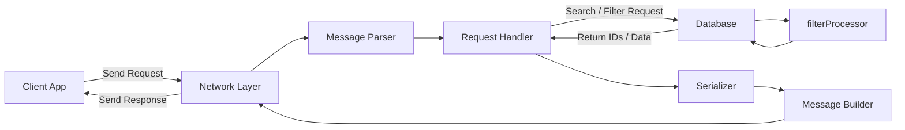
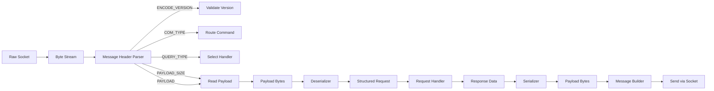
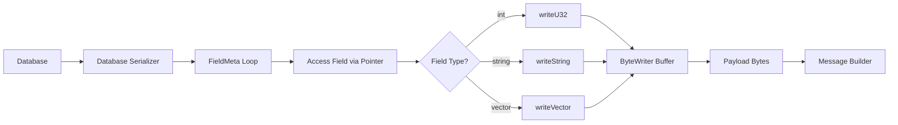
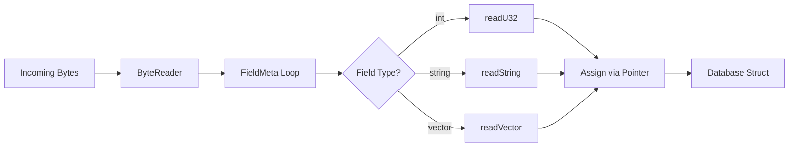
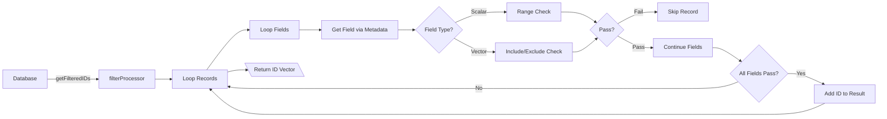
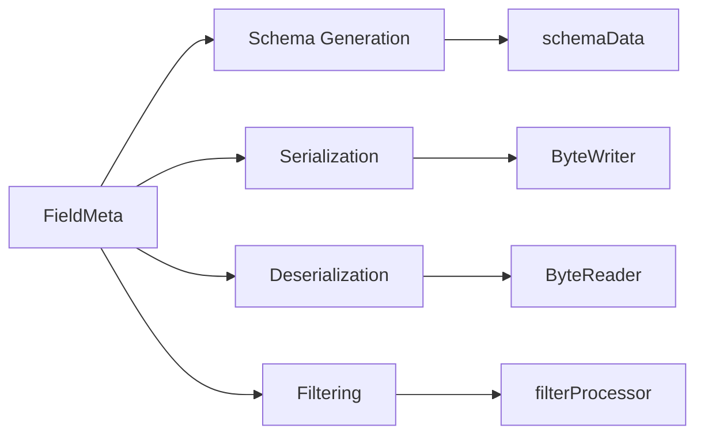
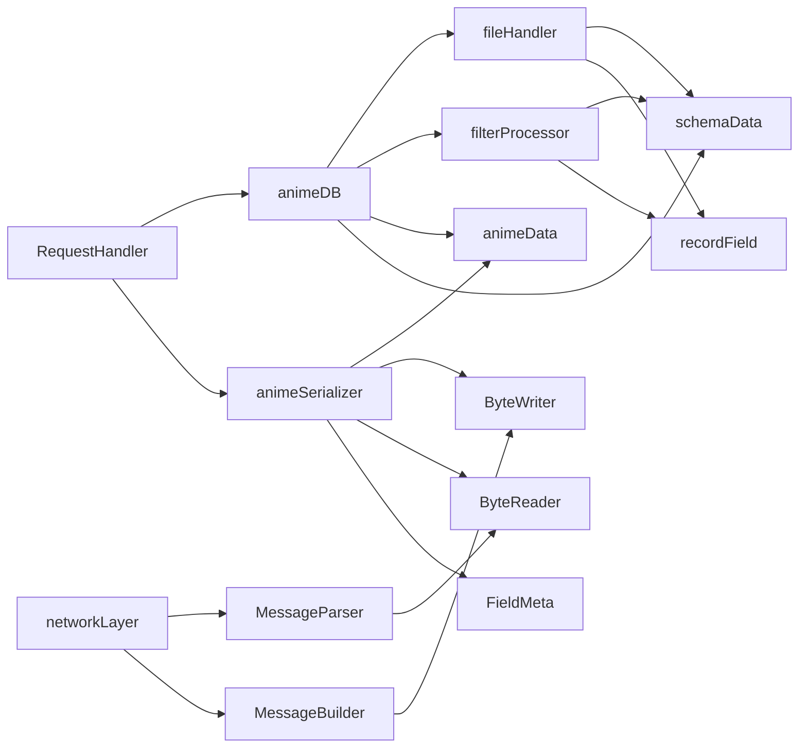
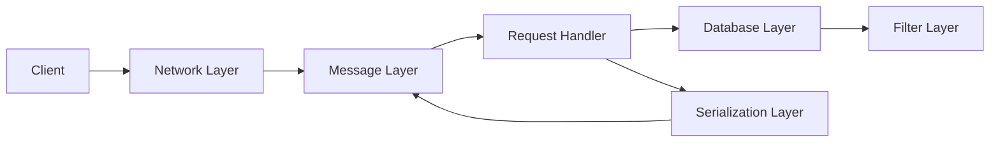

# AnimeDB Architecture Flowcharts

---
## High-Level Request Flow

---
## Network Stack

---
## Serialization

---
## De-Serialization

---
## Database and Filter Flow

---
## Meta-Data System

---
## Dependancies

---
## Architecture Layers
