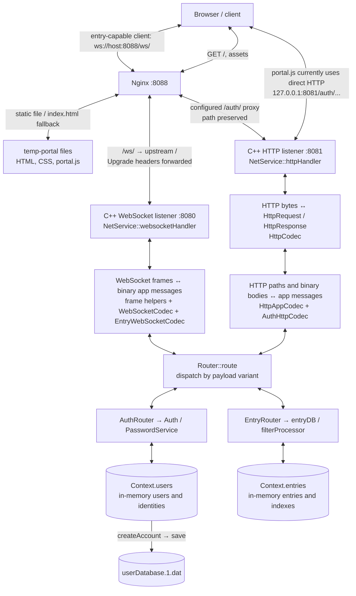
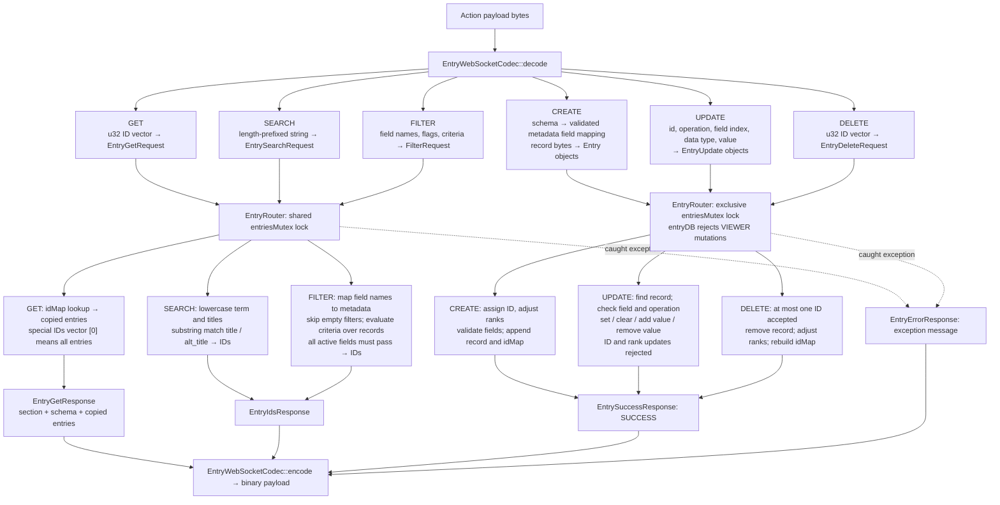
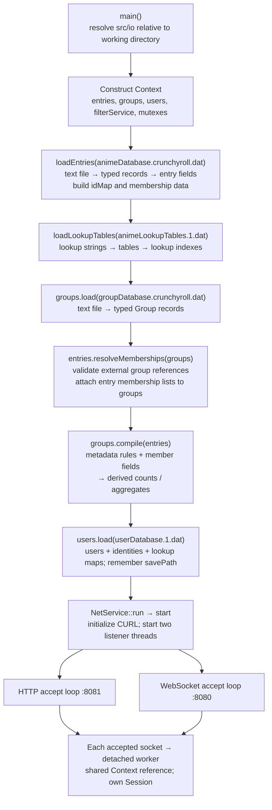
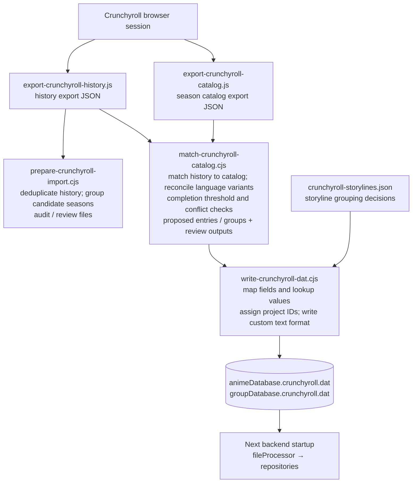

# Request and response logic map

This maps the current working tree, including the local `temp-portal` client and the checked-in Nginx configuration. Arrows describe code paths, not a claim that the servers are running. Names such as `Auth`, `Router`, and `entryDB` are components inside **one C++ backend process**, not separate deployed microservices.

For the proposed design with LibraryService coordinating entries/groups and shared authenticated sessions, see the [target architecture map](target-library-architecture.md).

## 1. Where the client connects



Bidirectional arrows represent requests going inward and responses returning outward. The detailed maps below name each transformation.

- The local portal's active forms use HTTP authentication. Its binary-envelope helpers are present, but `portal.js` does **not** open a WebSocket or implement an entry browsing flow.
- `/auth/` and `/ws/` are available proxy routes in Nginx; the current portal's hardcoded `HTTP_AUTH_BASE_URL` bypasses `/auth/`. On another computer, that URL points to that computer's loopback address.
- Nginx listens on plain HTTP `8088`; the backend uses plain TCP on `8080` and `8081`. The `SERVER_PORT = 443` constant is unused. The folder name `net/https` does not mean TLS is active.
- Both backend listeners bind using IPv4 `AI_PASSIVE`, rather than explicitly binding only to loopback.

Sources: [Nginx config](../nginx-1.31.3/conf/nginx.conf), [local portal](../temp-portal/portal.js), [network service](../src/net/transport/net_service.cpp), [ports](../src/net/transport/net_service.hpp).

## 2. WebSocket request and response, end to end

```mermaid
sequenceDiagram
    participant C as Entry-capable client
    participant N as Nginx :8088
    participant T as NetService :8080
    participant F as WebSocket frame helpers
    participant W as WebSocketCodec
    participant E as EntryWebSocketCodec
    participant R as Router / EntryRouter
    participant D as Context.entries

    C->>N: HTTP Upgrade /ws/
    N->>T: Upgrade / with forwarded headers
    T->>F: webSocketHandshake(socket)
    F->>F: Sec-WebSocket-Key + GUID → SHA-1 → Base64
    F-->>N: HTTP 101 + Sec-WebSocket-Accept
    N-->>C: Upgrade response
    Note over T,D: One Session per connection, initially signed out / VIEWER

    loop Each binary application frame
        C->>N: Masked binary frame: envelope + action payload
        N->>T: WebSocket traffic
        T->>F: readWebSocketFrame(socket)
        F->>F: Read length and mask; XOR unmask payload
        F-->>T: WebSocketFrame with unmasked ByteVector
        T->>W: decode(frame.payload)
        W->>W: Read version, type, domain, action, id, payload size
        W->>E: decode(action, action payload)
        E->>E: Bytes → typed EntryRequest variant
        E-->>W: Get / Update / Create / Delete / Search / Filter request
        W-->>T: AppRequest containing EntryRequest
        T->>R: route(request, shared Context, connection Session)
        R->>R: Dispatch variant; acquire entriesMutex
        R->>D: Repository operation; mutations receive session.role
        D-->>R: Entries / IDs / mutation completion, or exception
        R->>R: Release lock; caught exception → EntryErrorResponse
        R-->>T: AppResponse with same request id and EntryResponse
        T->>W: encode(original request, response)
        W->>E: encode(EntryResponse)
        E-->>W: Schema + records, ID vector, or message bytes
        W->>W: Add version, RESP, original domain/action, id, payload size
        W-->>T: Response ByteVector
        T->>F: sendWebSocketFrame(BINARY, response bytes)
        F-->>N: FIN binary frame, unmasked
        N-->>C: Response frame
        Note over C: Client must decode envelope, then action-specific response payload
    end
```

Control frames bypass the app router: `PING → PONG` echoes the payload, and `CLOSE → CLOSE` ends the connection. Other opcodes are skipped. Fragmented, extension-marked, and unmasked client frames are unsupported. A response with `closeConnection` set causes a close frame after its binary response; current entry handlers return `false`.

Decode/encode exceptions are outside the entry handler's catch blocks. They do **not** automatically become an error response; there is no outer worker exception handler. Only exceptions caught inside an entry operation follow the `EntryErrorResponse` return path.

Sources: [frame helpers](../src/net/websocket/webSocket.cpp), [envelope codec](../src/net/protocol/messenger.cpp), [entry codec](../src/protocol/entry_codec.cpp), [app router](../src/net/routing/router.cpp), [entry router](../src/app/entry_handler.cpp).

## 3. What each entry request becomes



The read/write nodes group the corresponding handlers; each handler calls only its own operation. Filtering uses a local `filterProcessor` and scans the records; the `Context.filterService` member is not the routed query processor. `validateFilter` is called, but its boolean return is currently ignored by `query`; it is not a guaranteed rejection boundary.

Search and filter return **IDs**, so a client needs a subsequent GET to retrieve full records. Entry mutations update memory; these handlers do not call `saveEntries`, rebuild lookup-table indexes, resolve group memberships, or recompile groups. Multi-record mutations have no rollback transaction.

Sources: [entry handlers](../src/app/entry_handler.cpp), [repository operations](../src/databases/entry_database.cpp), [filter query](../src/filtering/filterProcessor.tpp), [filter criteria](../src/filtering/filterProcessor.cpp), [schema mapping](../src/domain/entry_schema.cpp).

## 4. HTTP authentication request and response

```mermaid
sequenceDiagram
    participant C as portal.js / HTTP client
    participant N as Nginx (optional proxy)
    participant T as NetService :8081
    participant H as HttpCodec
    participant A as HttpAppCodec / AuthHttpCodec
    participant R as Router / AuthRouter
    participant S as Auth
    participant P as PasswordService
    participant U as Context.users
    participant D as userDatabase.1.dat

    Note over C,T: Current portal calls :8081 directly; /auth/ proxy is configured on :8088
    C->>T: POST /auth/login/password or /auth/create/password, binary body
    T->>T: One recv call, buffer capacity 512 bytes
    T->>H: decode(raw bytes)
    H-->>T: HttpRequest: method, target, version, headers, body
    T->>A: decode(HttpRequest)
    A->>A: Path → domain=AUTH, action, provider=PASSWORD
    A->>A: Length-prefixed body strings → AuthRequest variant
    A-->>T: AppRequest, id=0
    T->>R: route(request, Context, fresh Session)
    R->>S: login / create / logout

    alt Password login
        S->>U: Shared usersMutex: find identity by login key, copy identity and user
        U-->>S: User + identity including stored password hash
        S->>S: Reject disabled identity or user
        S->>P: Argon2id verify supplied secret against stored hash
        P-->>S: Match / no match
        S->>S: On success, set this HTTP Session's userId, role, signedIn
    else Account creation
        S->>P: Random salt via BCrypt; Argon2id hash(secret)
        P-->>S: Encoded password hash
        S->>U: Exclusive usersMutex: createAccount(request, hash)
        U->>U: Assign IDs; add user and identity; update login/email maps
        U->>D: save(savePath) via fileProcessor
        S->>S: Return success with VIEWER; creation does not sign in
    else Logout
        S->>S: Reset this HTTP Session to signed out / VIEWER
    end

    S-->>R: AuthResult: success, optional userId, role, error
    R-->>T: AppResponse: id=0, AuthResponse
    T->>A: encode(AppResponse)
    A->>A: AuthResult → HTTP 200 with one role byte, or 401 with error text
    A-->>T: HttpResponse with application/octet-stream body
    T->>H: encode(HttpResponse)
    H->>H: Status line + headers + Content-Length + body
    H-->>T: Wire bytes
    T-->>C: send(response bytes); proxy relays when used
    C->>C: arrayBuffer → first role byte on success; TextDecoder on failure
```

This is the normal return path for parseable requests. HTTP framing is currently a single `recv`, rather than a complete Content-Length-driven read loop. Parser failures and some auth/storage exceptions do not have a common conversion into an HTTP error response.

**Session boundary:** `httpHandler` creates a fresh local `Session` for its one exchange. No cookie, bearer token, or shared session lookup connects that result to a later request or to `websocketHandler`'s separate session. Consequently, a login response can report a role while a new WebSocket still has VIEWER permissions. The HTTP handler also lacks a normal-path socket close; its return should not be read as a complete connection-lifecycle implementation.

**Direct portal route:** the hardcoded `:8081` auth call is cross-origin when the page is served from `:8088`. Although `HttpResponse` has default CORS headers, `AuthHttpCodec` replaces the header map with Content-Type. Successful browser access across those origins is not established by the code path above.

Sources: [portal HTTP call](../temp-portal/portal.js), [HTTP transport](../src/net/transport/net_service.cpp), [HTTP codecs](../src/net/https/httpCodec.cpp), [auth routing and codecs](../src/databases/auth/auth_service.cpp), [password service](../src/databases/auth/password.cpp), [user repository](../src/databases/user_database.cpp).

## 5. Exact wire transformations

Application binary integers are big-endian. Strings are `u32 byteLength + string bytes`; unsigned vectors are `u32 elementCount + elements`. The portal encodes its strings with UTF-8.

### WebSocket envelope

This application envelope sits **inside** the WebSocket frame; WebSocket framing and masking are separate transformations.

| Field, in order | Size | Request | Response |
| --- | --- | --- | --- |
| Encode version | u32 | `1001` | `1001` |
| Communication type | u8 | normally `REQ = 1` | `RESP = 2` |
| Domain | u8 | `ENTRY = 1` supported | Original request domain |
| Action | u8 | GET / UPDATE / CREATE / DELETE / SEARCH / FILTER | Original request action |
| Correlation ID | u32 | Client-chosen ID | Same ID via `AppResponse.id` |
| Payload byte length | u32 | Action payload size | Encoded response payload size |
| Payload | variable | Action-specific binary fields | Response-specific binary fields |

The fixed application header is 15 bytes. The decoder checks the version and dispatches the domain/action; it does not validate that the supplied communication type is REQ.

| Entry response variant | Binary payload |
| --- | --- |
| GET success | Schema field count; each field's name/type/filter mode; actual returned record count; records in `entryMetadata` order |
| SEARCH / FILTER success | `u32 ID count + u32 IDs` |
| Mutation success | Length-prefixed `SUCCESS` string |
| Caught operation error | Length-prefixed error string |

The GET handler populates `section`, but the current encoder does **not** serialize it. There is also no success/error discriminator in the entry response envelope or payload; the error and mutation-success variants both encode only a string. GET/search/filter errors therefore do not have the successful action's payload shape.

### HTTP authentication bodies

| Route | Request body | Normal response |
| --- | --- | --- |
| `/auth/login/password` | `str(loginKey) + str(secret)` | 200 + one role byte; failed login: 401 + raw error text |
| `/auth/create/password` | `str(loginKey) + str(secret) + str(email) + str(displayName)` | 200 + one VIEWER role byte on success |
| `/auth/logout` | No fields decoded | 200 + one VIEWER role byte |
| `/auth/oauth/...` | Decode throws: not implemented | No completed OAuth path |

HTTP requests do **not** contain the WebSocket application envelope. `HttpAppCodec` supplies request ID `0`; the HTTP response does not serialize that ID, the optional user ID, or the full `AuthResult`. The current auth path chooses behavior from the URL; it does not enforce an HTTP method in `AuthHttpCodec`.

Sources: [byte reader/writer](../src/net/protocol/data.hpp), [byte writer implementation](../src/net/protocol/data.cpp), [message enums](../src/protocol/message_types.hpp), [entry codec](../src/protocol/entry_codec.cpp), [auth codec](../src/databases/auth/auth_service.cpp).

## 6. Startup, shared state, and persistence



The `.dat` files use a custom **text** format, distinct from the network's binary format. `fileProcessor::readFile` reads file header, sections, schema, and records, and invokes repository callbacks (`section`, `schema`, `record`, `table`). Schema names/types are mapped to domain metadata before records become C++ objects. Saving reverses that direction through the repository's `getHeader`, `getSection`, `getSchema`, and record-source functions.

| Data | Runtime owner | Disk write on current request path |
| --- | --- | --- |
| Entries and lookup data | `Context.entries` | None for entry create/update/delete; `saveEntries` exists separately |
| Group memberships and derived aggregates | `Context.groups` | Loaded/resolved/compiled at startup; no public group request route |
| Users and login identities | `Context.users` | Account creation calls `save(savePath)` |
| Authentication status | Individual connection handler's `Session` | None; no persistent shared HTTP/WS authentication session |

There is no external SQL server or per-request Crunchyroll call in these runtime paths. `run()` waits for listener threads. The current `stop()` flips `running` and cleans up CURL; it does not wake blocking socket operations or join detached client workers.

Sources: [startup](../src/main.cpp), [shared ownership](../src/app/context.hpp), [file reader](../src/io/readFile.tpp), [file writer](../src/io/saveFile.tpp), [group compiler](../src/domain/group_compiler.cpp), [network lifetime](../src/net/transport/net_service.cpp).

## 7. Offline data import path



Preparation is a separate candidate/audit step; the matching script takes the raw history and catalog exports directly. These scripts run offline from the server's request path. See [import notes](../src/io/crunchyroll-import-notes.md) and [storyline grouping policy](storyline-groups.md).

## 8. Paths that stop before reaching a service

| Apparent path | Current boundary |
| --- | --- |
| HTTP entry API | Request decoding rejects non-AUTH domains. Encoding an already-constructed EntryResponse over HTTP returns 405. |
| WebSocket authentication | Envelope decoding only supports ENTRY; encoding AuthResponse throws. |
| Groups, characters, users, standalone filters APIs | Enum names exist, but no transport decoding and routing path is wired for these domains. Entry FILTER is supported. |
| SORT / APPLY entry actions | Enum values exist; entry decoding does not implement them. `getSortedIDS` is nonfunctional. |
| OAuth provider exchange | HTTP decode rejects OAuth; OAuth methods are stubs. No completed external provider request/response chain. |
| Outbound HTTP client | `httpClient.cpp` is unfinished and excluded from the executable source list. |
| Portal WebSocket auth helpers | Leftover helpers are not the active form path; their auth envelope expectations do not match the active HTTP response format. Portal LOGOUT enum is also stale relative to the backend. |

This document describes the inspected implementation. It does not make the proposed persistence/service/lifetime changes discussed in [architecture-refactor.md](architecture-refactor.md).
