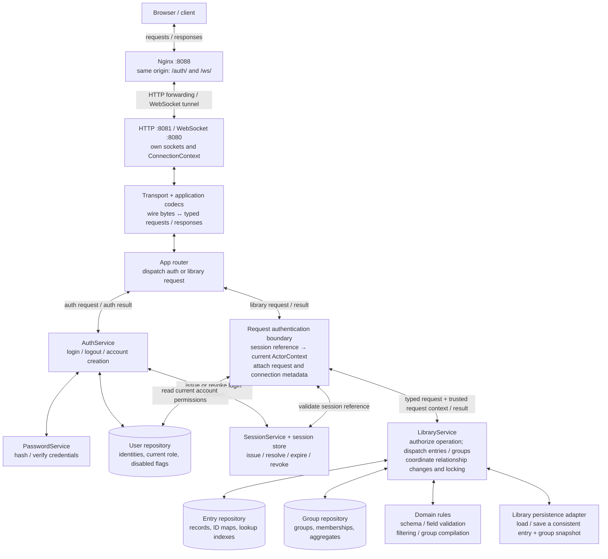
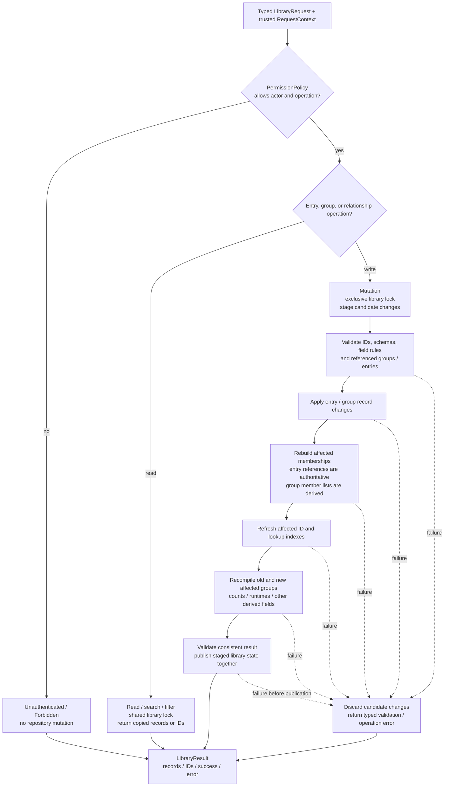
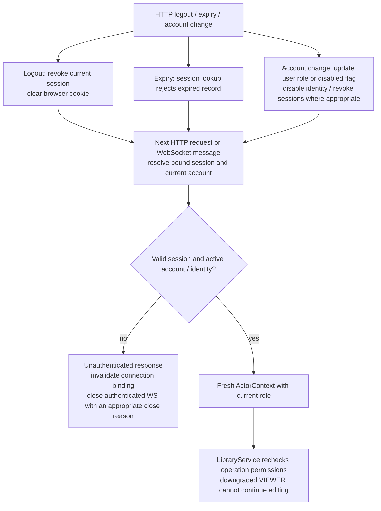

# Target architecture: LibraryService, authentication, and sessions

**Proposed design, not implemented behavior.** This is the goal-state companion to the [current request/response map](request-response-map.md). `LibraryService` coordinates the entry/group library inside the existing C++ process. Its internal connections are typed function calls and shared ownership boundaries; HTTP and WebSocket connections remain the network layer's responsibility.

## 1. Overall request and response map



Read inward arrows as requests and outward arrows as returned values. Auth results and library results return through the app response adapter, application codec, transport framing, and Nginx to the client. Repositories do not write to sockets.

The portal would use relative `/auth/...` URLs, so login and WebSocket upgrades share the same origin. Entry operations remain a WebSocket API in this proposal; a new group codec exposes group operations on the same connection. Adding an HTTP library API later would reuse the same authentication boundary and `LibraryService`.

## 2. Where each kind of state lives

| State | Owner and lifetime | Contents and use |
| --- | --- | --- |
| Account | User repository; persistent | User ID, current VIEWER/EDITOR/ADMIN role, disabled status. Source of truth for account permissions. |
| Login identity | User repository; persistent | Password hash/provider identity and disabled status. Used during authentication; never passed to LibraryService. |
| Login session | SessionService; login until expiry/revocation | Opaque credential reference, associated user/identity IDs, issue/expiry timestamps, revoked status. Shared across HTTP exchanges and WebSocket connections. Initial implementation can keep this store in memory, making restart require login again. |
| ConnectionContext | Transport; accepted connection until close | Connection ID, socket ownership, HTTP/WS protocol, peer address, cancellation/lifetime state, and optional bound session reference. It does not grant permissions. |
| ActorContext | Authentication boundary; one request | Authenticated flag, optional user ID, current role, optional session reference. Constructed from validated server-side data, never from a client-supplied role. |
| RequestContext | Application boundary; one request | ActorContext plus correlation ID and connection ID. Metadata supports logging and matching the response to its request. |
| Library state | LibraryService; backend lifetime | Entry and group repositories, relationship rules, synchronization, and persistence coordination. Shared by clients. |

`ConnectionContext` keeps a session **reference**, rather than treating the role captured when a socket opened as permanent authority. One login session can be used by multiple connections. A connection may also be anonymous. Disconnecting a socket removes that connection; it does not automatically log out every connection sharing the session.

The existing `net::Session` mixes signed-in state, user ID, and role inside a connection handler. The target design splits those concerns into the session store, connection state, and per-request actor. The existing `SessionId` integer alias is not, by itself, a client authentication credential; use an opaque, unguessable token.

## 3. Login → shared session → authorized WebSocket request

```mermaid
sequenceDiagram
    participant C as Browser
    participant N as Nginx / transport / codecs
    participant A as AuthService
    participant U as Users + PasswordService
    participant S as SessionService
    participant R as Request authentication boundary
    participant L as LibraryService

    C->>N: POST /auth/login/password with binary credentials
    N->>A: Typed login request
    A->>U: Find identity/user; check disabled flags; verify password
    U-->>A: Authenticated account identity
    A->>S: Create session bound to user and login identity
    S-->>A: Opaque session token + expiry
    A-->>N: Auth result + session issuance instruction
    N-->>C: HTTP 200; Set-Cookie for session; role in response body
    Note over C,S: HttpOnly, same-origin cookie; Secure when TLS is deployed

    C->>N: WebSocket Upgrade /ws/ with session cookie
    N->>R: Credential + connection metadata; validate browser Origin
    R->>S: Resolve token; check expiry and revocation
    S-->>R: Validated session reference
    R->>U: Check current user and identity state
    U-->>R: Active account
    R-->>N: Bind session reference to ConnectionContext
    N-->>C: HTTP 101; WebSocket connected

    loop Every library message
        C->>N: Binary envelope + entry/group command
        N->>R: Typed request + connection's session reference
        R->>S: Revalidate session
        S-->>R: Session user/identity IDs, or authentication failure
        R->>U: Read active account/identity and current role
        U-->>R: Example: user 42, EDITOR, active
        R->>L: execute(request, RequestContext with trusted ActorContext)
        L->>L: PermissionPolicy: actor allowed to perform this operation?
        L->>L: Read or mutate coordinated entry/group state
        L-->>N: Typed result or typed application error
        N-->>C: Encode response envelope and frame; same correlation ID
    end
```

Only the login exchange handles the password. Later requests use the session reference. The role byte shown to the browser is display information; sending `ADMIN` in a request does not change the server's actor.

For HTTP, resolve the cookie on **each exchange**, even if the TCP connection is reused. For WebSocket, validate at upgrade and revalidate the bound session before each application request. A newly logged-in browser reconnects an existing anonymous WebSocket to bind the new session. Cookie-authenticated HTTP mutations also need the chosen Origin/CSRF check at the HTTP boundary.

A request without a credential can become an anonymous actor for public reads. A supplied invalid/expired credential produces an authentication error; it is not silently accepted as a logged-in actor. Resolve session/user snapshots without holding their locks while acquiring the library lock.

## 4. LibraryService dispatch and relationship management



`LibraryService` is the application entry point for library operations, including jobs/imports that update the running library. Existing entry/group handlers can become thin typed adapters under it. It owns the repositories privately, or exclusively controls their mutation access; network routers cannot bypass it to call `entryDB` or `groupDB` directly.

For the first implementation, one library-level read/write lock makes entry/group updates consistent without nested repository-lock ordering. Repository helpers used inside this boundary must not reacquire the same lock. Readers receive copies/snapshots, so references do not outlive a protecting lock. Copying a candidate library snapshot is a simple starting transaction strategy; optimize only when necessary.

| Operation | What LibraryService coordinates |
| --- | --- |
| Get/search/filter entries or groups | Authorize read; dispatch to appropriate repository/filter processor; return records/IDs. |
| Create entry | Validate group references; assign entry ID; add record; update membership and indexes; compile affected groups. |
| Update entry metadata | Validate patch; apply it; refresh affected indexes and derived group values. |
| Move entry from group A to B | Validate both groups; update entry reference; remove/add derived membership; compile A and B; publish together. |
| Delete entry | Remove record and all corresponding memberships/index references; repair ranks as required; compile affected groups. |
| Create/update group | Validate editable fields and references. Derived member lists/aggregate fields are computed rather than accepted as independent client truth. |
| Delete group | Initial policy: reject a group that still has members. A future explicit reassign/detach command must update every affected entry in the same transaction. |
| Load/import library | Parse entries and groups into candidate state; validate references; construct indexes/memberships; compile; publish complete snapshot. |
| Save library | Capture a coherent entries/groups snapshot at one revision; hand it to the persistence adapter. |

**Persistence contract:** the initial service can preserve explicit-save behavior: a mutation success means committed in memory; a separate save result confirms persistence. Do not label a memory-only mutation as durably saved. If automatic durable commits are added, entries and groups need a recoverable paired-snapshot commit (for example, versioned files selected by one manifest); two independent file overwrites do not provide a transaction.

## 5. Account permissions and concrete examples

This is a **proposed policy** using the existing role enum. It keeps public reads and makes library writes require a signed-in account. User/role administration remains a separate auth/account operation.

| Operation | Anonymous | Signed-in VIEWER | EDITOR | ADMIN |
| --- | --- | --- | --- | --- |
| Browse/get/search/filter public entries and groups | Allow | Allow | Allow | Allow |
| Create/update/delete entries and groups | Deny | Deny | Allow | Allow |
| Change entry/group relationships | Deny | Deny | Allow | Allow |
| Import into or explicitly save the running library | Deny | Deny | Deny | Allow |
| Change account roles / disable accounts | Deny | Deny | Deny | Allow, through account administration |

Every mutating `LibraryService` entry point invokes the policy before taking a mutation lock. Business validation still applies after permission succeeds: an ADMIN cannot create a dangling reference or directly overwrite a derived aggregate. The repository role parameters currently in `entryDB` should be replaced by this explicit service authorization boundary as callers migrate; ordinary clients must not be able to invoke internal mutation helpers.

```mermaid
sequenceDiagram
    participant C as Client on connection 17
    participant R as Authentication boundary
    participant S as SessionService + user repository
    participant L as LibraryService
    participant E as Entry repository
    participant G as Group repository / compiler

    C->>R: Request 901: move entry 5 from group 2 to group 9
    R->>S: Resolve bound session; read current account
    S-->>R: userId=42, authenticated=true, role=EDITOR
    R->>L: MoveEntry + ActorContext; requestId=901, connectionId=17
    L->>L: Allow EDITOR; acquire exclusive library lock; stage changes
    L->>E: Check entry and its current group reference
    L->>G: Check target group 9 exists
    L->>E: Stage group reference 2 → 9
    L->>G: Stage memberships; compile groups 2 and 9
    L->>L: Validate and publish together; release lock
    L-->>C: Via codecs and transport: response 901, success
    Note over R,L: VIEWER → Forbidden before mutation; invalid session → Unauthenticated
```

Connection ID `17` tells the transport/logs which connection is involved. Request ID `901` correlates the response. User ID `42` identifies the actor. The **server-resolved EDITOR permission** authorizes the move. None of these IDs alone grants access.

## 6. Logout, expiry, and permission changes



Revocation takes effect at the next authentication check; an already-authorized request may finish. Immediate cancellation of in-flight work would be an additional guarantee. With a connection registry, SessionService can notify transports to close affected sockets promptly, but authorization must still work without that notification. Background jobs require an explicit trusted actor and policy rather than silently receiving ADMIN.

## 7. Current code → target responsibilities

| Current code | Target change |
| --- | --- |
| [Context](../src/app/context.hpp) publicly exposes entries, groups, users, and mutexes | Compose LibraryService, AuthService, SessionService, and transport dependencies; make library mutation access private. |
| [Router](../src/net/routing/router.cpp) passes a connection-local Session into handlers | Route auth operations to AuthService; resolve trusted RequestContext for library operations. |
| [EntryRouter](../src/app/entry_handler.cpp) locks and directly calls entryDB | Delegate library authorization and coordinated mutations to LibraryService. |
| [entryDB](../src/databases/entry_database.cpp) checks a supplied role | Keep storage/domain operations behind the authorized LibraryService boundary; maintain all affected indexes. |
| [groupDB](../src/databases/group_database.hpp) and [group compiler](../src/domain/group_compiler.cpp) are not publicly routed | Add typed group request/response adapters and codec support; coordinate changes through LibraryService. |
| [Auth](../src/databases/auth/auth_service.cpp) writes user/role into a local Session | Issue/revoke shared login sessions; resolve current permissions separately for each request. |
| [net::Session](../src/net/transport/session.hpp) is local to each handler; [auth/session.hpp](../src/databases/auth/session.hpp) is a placeholder | Introduce explicit session records, ConnectionContext, ActorContext, and RequestContext with the lifetimes above. |
| [Network handlers](../src/net/transport/net_service.cpp) lack a common error boundary | Catch parse/auth/application failures; encode typed errors; own connection shutdown. |
| [Entry wire codec](../src/protocol/entry_codec.cpp) lacks a success/error discriminator | Version the response contract to carry explicit success/error codes; add group payloads. HTTP errors use corresponding status codes. |
| [Portal](../temp-portal/portal.js) directly calls :8081 | Use same-origin auth URLs, accept the session cookie, and connect/reconnect /ws/ after login. |

Suggested implementation order: define request/actor contexts and session resolution; connect HTTP login to WebSocket identity; establish LibraryService and permission policy; migrate entry operations; add group/relationship operations and atomic in-memory changes; add snapshot persistence and protocol/error adapters. Each stage should keep this target map distinct from the current implementation map until its behavior is delivered.
